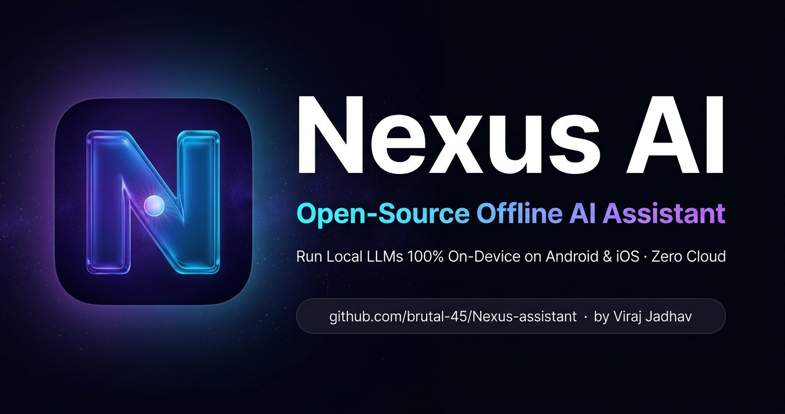

<div align="center">
<a href="https://github.com/brutal-45/Nexus-assistant">
  
</a>

# Nexus AI — Open-Source Offline AI Assistant

**Nexus AI (`Nexus Assistant`) by [Viraj Jadhav (`@brutal-45`)](https://github.com/brutal-45) is a 100% offline, private on-device AI assistant for Android and iOS. Run local GGUF & LiteRT Large Language Models directly on your phone — no cloud servers, no accounts, and zero data leaving your device.**

[](https://github.com/brutal-45/Nexus-assistant/releases/latest)
[](https://github.com/brutal-45/Nexus-assistant/actions/workflows/ci.yml)
[](LICENSE)
[](https://github.com/brutal-45)
[](https://brutal-45.github.io/Nexus-assistant/)

[Download APK / IPA](https://github.com/brutal-45/Nexus-assistant/releases/latest) · [Official Website](https://brutal-45.github.io/Nexus-assistant/) · [Model Catalog](models/README.md) · [Report an Issue](https://github.com/brutal-45/Nexus-assistant/issues)
</div>

---

## Why Nexus AI Stands Out Among Open-Source AI Projects on GitHub

Unlike mobile AI apps that act as thin wrappers around paid cloud APIs, **Nexus AI (`brutal-45/Nexus-assistant`)** executes real neural inference locally on mobile silicon using React Native and `llama.cpp` (`llama.rn`):

- **100% Offline & Verifiable Privacy:** Works in airplane mode, underground, or completely off-grid. Zero servers, zero user accounts, and zero telemetry — every line of source code is open and auditable under the MIT License.
- **RAM-Aware Smart Model Catalog (`Nexus 1.0 Nano` → `Nexus 3.5 Reasoner`):** Automatically profiles device memory (3 GB to 12 GB+ RAM) and recommends optimal quantized models across **Llama 3.1**, **Qwen 3 / 3.5 / 2.5 Coder**, **Google Gemma 3 & 4**, **Mistral / Ministral**, **Phi-4 Mini**, **SmolLM3**, **Liquid LFM2.5**, and **DeepSeek R1 Distill**.
- **Multimodal Vision & Offline Voice:** Pair Vision-Language Models (VLMs) with camera or gallery photos, talk hands-free with on-device speech recognition & synthesis, and customize behavior with **AI Pals** and custom system prompts.
- **Direct Hugging Face GGUF Hub Integration:** Search, inspect, and download thousands of community GGUF and LiteRT models directly inside the app.
- **Hardware Acceleration & Benchmarking:** Leverages **Apple Metal** on iOS and **OpenCL / CPU / NPU** runtimes on Android, complete with draft-model **speculative decoding** and built-in token/second hardware benchmarking.
- **In-App Release Updates:** Installed devices can check GitHub Releases for new signed Android `.apk` and iOS `.ipa` builds with one tap.

## Project Overview & Technical Identity

| Property | Value |
|---|---|
| Project / App Name | **Nexus AI** (`Nexus` / `Nexus Assistant`) |
| Author & Maintainer | [**Viraj Jadhav** (`@brutal-45`)](https://github.com/brutal-45) |
| GitHub Repository | [`github.com/brutal-45/Nexus-assistant`](https://github.com/brutal-45/Nexus-assistant) |
| Official Project Site | [`brutal-45.github.io/Nexus-assistant`](https://brutal-45.github.io/Nexus-assistant/) |
| Android `applicationId` & iOS Bundle ID | `com.nexusai.nexus` |
| Deep-Link Scheme | `nexus://` |
| Current Version | `1.18.5` (build `10`) |
| License | [MIT License](LICENSE) — Copyright (c) 2026 Viraj Jadhav |

## Download & Quick Start

### Install Prebuilt App (Android & iOS)

1. Open [**Latest GitHub Release (`v1.18.5`)**](https://github.com/brutal-45/Nexus-assistant/releases/latest).
2. **Android:** Download `Nexus-*.apk` and open it on your phone (or use `Nexus-*.aab` for Google Play distribution).
3. **iOS:** Download `Nexus-*.ipa` and install via AltStore, Sideloadly, or TrollStore.
4. Open the **Models** tab → choose a recommended **Nexus** model matched to your phone's RAM → tap **Load** and chat offline.

### Build from Source (Debug Builds)

Prerequisites: Node `22.21.0+`, Yarn `1.22.22`, JDK `17`, Android Studio (SDK 35/36), Xcode `16+`, CocoaPods.

```bash
git clone https://github.com/brutal-45/Nexus-assistant.git
cd Nexus-assistant
yarn install
cd ios && bundle exec pod install && cd ..

yarn android                 # run on Android device/emulator
yarn ios                     # run on iOS device (Metal) / simulator (CPU-only)
```

## Release Builds

### Android (APK + AAB)

```bash
# 1) Create your release keystore (back it up — lost key = lost update channel).
#    Filename and alias match android/app/build.gradle -> signingConfigs.release:
keytool -genkeypair -v -storetype PKCS12 \
  -keystore android/app/nexus-release-key.keystore \
  -alias nexus_key_alias -keyalg RSA -keysize 2048 -validity 10000

# 2) Provide signing passwords via .env (see .env.example) or environment variables:
#    APP_RELEASE_STORE_PASSWORD=...  APP_RELEASE_KEY_PASSWORD=...
#    Without them, the build falls back to debug signing automatically.

cd android && ./gradlew assembleProdRelease bundleProdRelease
# -> app/build/outputs/apk/prod/release/app-prod-release.apk
# -> app/build/outputs/bundle/prodRelease/app-prod-release.aab
```

### iOS (IPA)

```bash
cd ios && bundle exec pod install
open PocketPal.xcworkspace
```

1. Select the `PocketPal` target → **Signing & Capabilities** → your Apple team + bundle ID `com.nexusai.nexus`.
2. **Product → Archive → Distribute App**.

For automated unsigned `.ipa` builds (installable via AltStore, Sideloadly, or TrollStore), `.github/workflows/ios-release.yml` builds and attaches `Nexus-<tag>.ipa` on every `v*` tag push or manual dispatch.

## Nexus Model Lineup & Custom Models

- **Built-in 21-model Nexus catalog:** the Models tab recommends the **Nexus lineup** (`Nexus 1.0 Nano` at ~230 MB through `Nexus 3.5 Reasoner`, `Nexus 3.4 Coder`, and `Nexus 3.3 Max`) automatically matched to device RAM. See [`models/README.md`](models/README.md) for the complete specification table.
- **Publish model packs on GitHub:** place `.gguf` / `.litertlm` / `.task` files in `models/` (Git LFS supported) and run **Actions → Model Release** to publish versioned release assets (up to 2 GiB per file).
- **RAM sizing guidance:** sub-4 GB devices → ≤1 GB `Q4_K_M` (`n_ctx: 1024`); 6–8 GB → 1.5–4B; 8–12 GB+ → 7–8B.

## Automated Workflows (GitHub Actions)

| Workflow | Trigger | Produces |
|---|---|---|
| `CI` (`ci.yml`) | PR / push to `master` or manual run | Translations, font, lint, typecheck & Jest unit test gates |
| `Android Release (APK + AAB)` (`release.yml`) | push tag `v*` or manual run | Signed **APK + AAB** artifacts & GitHub Release |
| `iOS Release (IPA)` (`ios-release.yml`) | push tag `v*` or manual run | Unsigned **IPA** artifact & GitHub Release |
| `Model Release` (`model-release.yml`) | manual run (`version` input) | **Model pack** attached to a GitHub Release |

To cut a new release:

```bash
git tag v1.18.6 && git push origin v1.18.6
```

See [`docs/RELEASE_REQUIREMENTS.md`](docs/RELEASE_REQUIREMENTS.md) for optional signing and service secrets.

## Frequently Asked Questions (FAQ)

### What is Nexus AI (Nexus Assistant) by brutal-45?
**Nexus AI** (also known as **Nexus Assistant**) is an open-source, 100% offline personal AI assistant app for Android and iOS created and maintained by **Viraj Jadhav** ([`@brutal-45`](https://github.com/brutal-45)). Built with React Native and `llama.cpp` (`llama.rn`), it runs quantized GGUF and LiteRT language models directly on mobile devices without cloud servers or telemetry.

### Does Nexus Assistant work completely offline without internet?
Yes. After downloading a model onto your phone, every token of inference runs locally on your device's CPU, GPU (Apple Metal on iOS, OpenCL on Android), or NPU — including in airplane mode or off-grid environments.

### Which local LLMs can I run in Nexus AI?
Nexus ships a curated 21-model catalog spanning **Llama 3.1 8B**, **Qwen 3 / 3.5 / 2.5 Coder**, **Gemma 3 & Gemma 4**, **Mistral 7B & Ministral**, **Phi-4 Mini**, **SmolLM3**, **Liquid LFM2.5 (including Vision)**, and **DeepSeek R1 Distill**, plus any compatible GGUF model from Hugging Face.

### Who created Nexus Assistant (`brutal-45` / Viraj Jadhav)?
Nexus Assistant is developed and maintained by **Viraj Jadhav** on GitHub under [`brutal-45`](https://github.com/brutal-45) (often searched as `brutal-45` or `brutal -45`) at [`github.com/brutal-45/Nexus-assistant`](https://github.com/brutal-45/Nexus-assistant).

### How do I update Nexus AI on my phone?
Installed devices automatically check this repository's latest GitHub Release (at most once every 24 hours) and offer a one-tap update, or you can check manually via **About → Updates → Check for updates**.

## Author & Maintainer

- **Viraj Jadhav** — GitHub: [@brutal-45](https://github.com/brutal-45) (`brutal-45`)
- **Repository:** [https://github.com/brutal-45/Nexus-assistant](https://github.com/brutal-45/Nexus-assistant)
- **Project Website:** [https://brutal-45.github.io/Nexus-assistant/](https://brutal-45.github.io/Nexus-assistant/)

## Contributing

Contributions, bug reports, and feature requests are welcome! Please read [`CONTRIBUTING.md`](CONTRIBUTING.md) and [`CODE_OF_CONDUCT.md`](CODE_OF_CONDUCT.md) before opening a pull request.

## License

Released under the [MIT License](LICENSE) — Copyright (c) 2026 **Viraj Jadhav** (`brutal-45`).

> **Note:** Language model weights (Gemma, Llama, Qwen, Mistral, DeepSeek, etc.) are governed by their respective model licenses. Always verify a model's license terms before redistributing weights.
