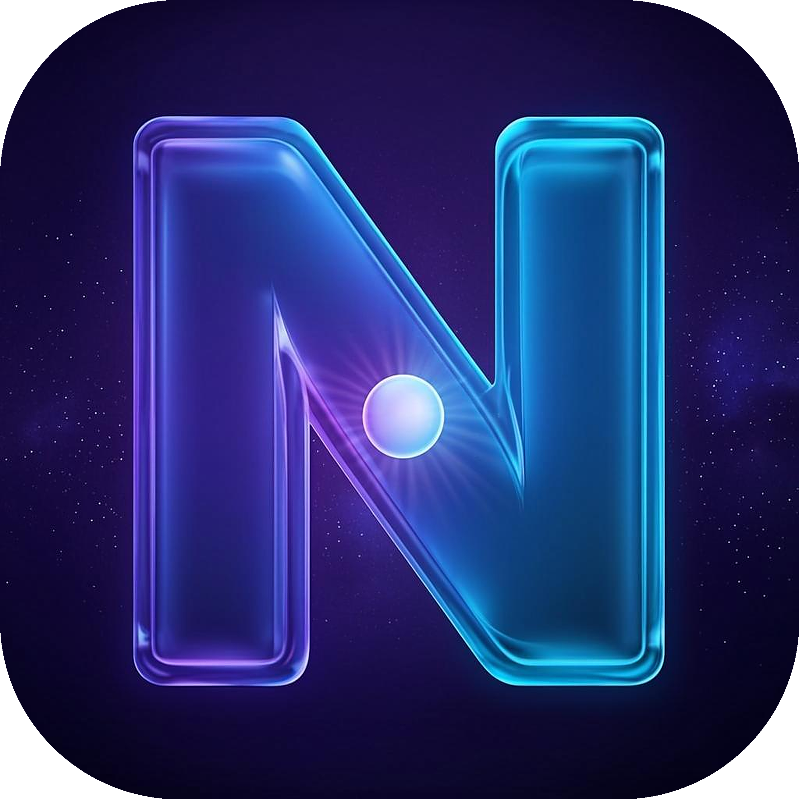

<div align="center">


# Nexus

**A private AI assistant that runs entirely on your phone. Chat with language models fully on-device — no server, no account, no data leaving your device.**

[](LICENSE)

iOS + Android · Maintained by [Viraj Jadhav](https://github.com/brutal-45) · Powered by React Native + `llama.cpp` (`llama.rn`)
</div>

---

## Overview

Nexus brings local, offline large language models to mobile devices with automatic RAM-aware tuning, multimodal vision & voice support, speculative decoding, customizable AI Pals, and built-in hardware benchmarking.

| Property | Value |
|---|---|
| App display name | `Nexus` |
| Android `applicationId` | `com.nexusai.nexus` |
| iOS bundle ID | `com.nexusai.nexus` |
| Deep-link scheme | `nexus://` |
| Current version | `1.18.5` (build `10`) |
| License | [MIT](LICENSE) — Copyright (c) 2026 Viraj Jadhav |

## Quick Start (Debug Builds)

Prerequisites: Node `22.21.0+`, Yarn `1.22.22`, JDK `17`, Android Studio (SDK 35/36), Xcode `16+`, CocoaPods.

```bash
yarn install
cd ios && bundle exec pod install && cd ..

yarn android                 # run on Android device/emulator
yarn ios                     # run on iOS device (Metal) / simulator (CPU-only)
```

First launch: open the **Models** tab → pick a recommended **Nexus** model for your device RAM (or search Hugging Face for any GGUF) → download → tap **Load** and chat offline.

## Release Builds

### Android (APK + AAB)

```bash
# 1) Create your release keystore (back it up — lost key = lost update channel).
#    Filename and alias match android/app/build.gradle -> signingConfigs.release:
keytool -genkeypair -v -storetype PKCS12 \
  -keystore android/app/nexus-release-key.keystore \
  -alias nexus_key_alias -keyalg RSA -keysize 2048 -validity 10000

# 2) Provide signing passwords via .env (see .env.example) or environment variables:
#    APP_RELEASE_STORE_PASSWORD=...  APP_RELEASE_KEY_PASSWORD=...
#    Without them, the build falls back to debug signing automatically.

cd android && ./gradlew assembleProdRelease bundleProdRelease
# -> app/build/outputs/apk/prod/release/app-prod-release.apk
# -> app/build/outputs/bundle/prodRelease/app-prod-release.aab
```

### iOS (IPA)

```bash
cd ios && bundle exec pod install
open PocketPal.xcworkspace
```

1. Select the `PocketPal` target → **Signing & Capabilities** → your Apple team + bundle ID `com.nexusai.nexus`.
2. **Product → Archive → Distribute App**.

For automated unsigned `.ipa` builds (installable via AltStore, Sideloadly, or TrollStore), `.github/workflows/ios-release.yml` builds and attaches `Nexus-<tag>.ipa` on every `v*` tag push or manual dispatch.

## Staying Up to Date

Installed devices check this repository's latest GitHub Release (at most once a day) and show a one-tap update dialog with a direct link to the latest APK (Android) or IPA (iOS). You can also check manually via **About → Updates → Check for updates**.

## Nexus Model Lineup & Custom Models

- **Built-in Nexus catalog:** the Models tab recommends the **Nexus lineup** (Nexus 1.0 Nano → Nexus 3.5 Reasoner) automatically matched to device RAM. See [`models/README.md`](models/README.md) for the full table.
- **Publish model packs on GitHub:** place `.gguf` / `.litertlm` / `.task` files in `models/` (Git LFS supported) and run **Actions → Model Release** to publish versioned release assets (up to 2 GiB per file).
- **Sizing guidance:** sub-4 GB devices → ≤1 GB `Q4_K_M` (`n_ctx: 1024`); 6–8 GB → 1.5–4B; 12 GB+ → 7–8B.

## Automated Workflows (GitHub Actions)

| Workflow | Trigger | Produces |
|---|---|---|
| `CI` (`ci.yml`) | PR / push to `master` or manual run | Translations, font, lint, typecheck & Jest unit test gates |
| `Android Release (APK + AAB)` (`release.yml`) | push tag `v*` or manual run | Signed **APK + AAB** artifacts & GitHub Release |
| `iOS Release (IPA)` (`ios-release.yml`) | push tag `v*` or manual run | Unsigned **IPA** artifact & GitHub Release |
| `Model Release` (`model-release.yml`) | manual run (`version` input) | **Model pack** attached to a GitHub Release |

To cut a new release:

```bash
git tag v1.18.6 && git push origin v1.18.6
```

See [`docs/RELEASE_REQUIREMENTS.md`](docs/RELEASE_REQUIREMENTS.md) for optional signing and service secrets.

## Contributing

Contributions, bug reports, and feature requests are welcome! Please read [`CONTRIBUTING.md`](CONTRIBUTING.md) and [`CODE_OF_CONDUCT.md`](CODE_OF_CONDUCT.md) before opening a pull request.

## License

Released under the [MIT License](LICENSE) — Copyright (c) 2026 **Viraj Jadhav** (`brutal-45`).

> **Note:** Language model weights (Gemma, Llama, Qwen, Mistral, DeepSeek, etc.) are governed by their respective model licenses. Always verify a model's license terms before redistributing weights.
